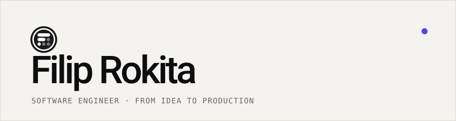
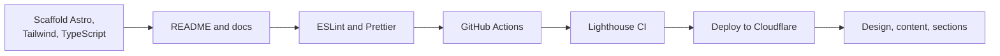

# filiprokita.com

  <picture>
    <source media="(prefers-color-scheme: dark)" srcset="docs/brand/banner-dark.svg">
    
  </picture>

  
  
  
  
  
  

 

> [!NOTE]
> **Status: early setup.** The dev environment and project rules are in place.
> The site itself (design, content, sections) is not built yet.

Personal portfolio of **Filip Rokita**. **Fast, static and simple to maintain.**

📬 Contact: `contact@filiprokita.com`

## 📖 Table of contents

1. [🎯 Goals](#-goals)
2. [🧱 Stack](#-stack)
3. [🧭 Principles](#-principles)
4. [🚀 Run it locally](#-run-it-locally)
5. [🗺️ Roadmap](#️-roadmap)
6. [📚 Documentation](#-documentation)

## 🎯 Goals

| | Goal | How |
| :-: | :--- | :--- |
| ✨ | **Look good** | A modern design with tasteful motion |
| ⚡ | **Be fast** | Static output, minimal client-side JavaScript, Lighthouse 100 as a goal |
| 🛠️ | **Stay simple** | Few dependencies, standard tooling, clear docs |

## 🧱 Stack

| Layer | Technology |
| :--- | :--- |
| Framework | [Astro](https://astro.build) with static output |
| Language | TypeScript (strict) |
| Styling | [Tailwind CSS](https://tailwindcss.com) v4 via `@tailwindcss/vite` |
| Images | `<Image />` from `astro:assets` |
| Animation | Plain CSS first, a library only if CSS is not enough |
| Interactivity | React only where it is truly needed |
| Hosting | Cloudflare (static assets) |
| Runtime | Node 26 (LTS), npm |

## 🧭 Principles

- 🧩 **Standard over clever.** Idiomatic Astro, no tricks written only to raise a
  score. Lighthouse 100 is a goal, not a requirement.
- 🪶 **Minimum client-side JavaScript.** Ship HTML and CSS by default.
- ♿ **Strict typing and accessibility.** TypeScript strict, semantic HTML, WCAG AA.
- 🔓 **No vendor lock-in.** Prefer standard APIs over one vendor's features.
- 📦 **Every dependency is justified** by what it gives against its cost in speed
  and size.

## 🚀 Run it locally

Everything runs inside a dev container. Open the repo in VS Code and choose
**Dev Containers: Reopen in Container**. See
[Dev environment](docs/dev-environment.md) for details.

> [!TIP]
> The Astro project is not scaffolded yet, so there are no run commands for now.
> They will live in `package.json` and in the dev environment doc.

## 🗺️ Roadmap

## 📚 Documentation

| Doc | What it covers |
| :--- | :--- |
| [🏛️ Architecture](docs/architecture.md) | Technical decisions and the build and deploy flow |
| [🧰 Dev environment](docs/dev-environment.md) | The dev container and tooling |
| [🗂️ Repo layout](docs/repo-layout.md) | What every entry in the repository root is for |
| [🔐 GitHub settings](docs/github-settings.md) | Repository protections: enabled and planned |

Rules for contributors and coding agents live in [`AGENTS.md`](AGENTS.md).
