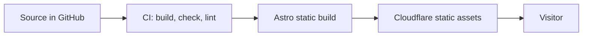

# 🏛️ Architecture

The technical decisions behind the site and why they were made.

## Overview

A static site. Astro builds HTML, CSS and optimized images at build time, and a
CDN serves them. There is no server code and no database.

## Pages

| Route | What it is |
| :--- | :--- |
| `/` | Home: hero, About, What I do, How I work, Projects, Contact |
| `/projects/<id>/` | One case study per visible project, from the content collection |
| `/404` | Not found page |
| `/robots.txt`, `/sitemap-index.xml` | Generated at build time |

Every page shares `BaseLayout`, which sets the title, canonical link, Open Graph
and Twitter tags, and optional JSON-LD (a Person on the home page). Section and
list layouts are components (`Section`, `ItemGrid`, `Figure`, `ProjectRow`).
The copy of the list sections lives in `src/config/home.ts`.

## Decisions

| Decision | Choice | Why |
| :--- | :--- | :--- |
| Framework | Astro, static output | Zero JavaScript by default, best fit for a fast content site |
| Language | TypeScript strict | Catches mistakes early, keeps the code maintainable |
| Styling | Tailwind CSS v4 | Fast to work with, unused CSS is dropped at build |
| Images | `astro:assets` | Modern formats, correct sizes and lazy loading without extra work |
| Animation | CSS first | No JavaScript cost. A library only if CSS cannot do it |
| Page transitions | Native CSS first | `<ClientRouter />` adds client JavaScript, so it is added only if CSS is not enough |
| Interactivity | A few small vanilla scripts, no framework | The page works without them. React only if a feature truly needs it |
| Blueprint mode | A lazy module behind a small chip | Only the chip ships to everyone. The drawing loads on first use. See [Blueprint mode](blueprint.md) |
| Hosting | Cloudflare Workers static assets | Fast CDN, free for static sites, no adapter needed. Configured in `wrangler.jsonc` |
| Package manager | npm | Ships with Node. Corepack is no longer bundled since Node 25 |
| Quality gates | ESLint, Prettier, `astro check`, Playwright with axe, Lighthouse CI, gitleaks | Every change is checked by CI before it reaches `main`. See [Testing](testing.md) |

## Performance approach

Lighthouse 100 is a goal, not a requirement. The standard practices below usually
get there without extra effort:

- Static output and minimal client-side JavaScript.
- Optimized images with explicit dimensions.
- Self-hosted fonts with `font-display: swap` and few weights.
- Semantic HTML, sensible headings, `alt` text, good contrast.
- Animations on `transform` and `opacity`, with `prefers-reduced-motion` respected.

If a score is lost to a design choice such as a large hero image or an animation,
the decision is made on purpose. A workaround that only exists to raise the score
and hurts code clarity is not worth it.

## Open points

- Browser tests cover Chromium only. See the known limitations in [Testing](testing.md).
