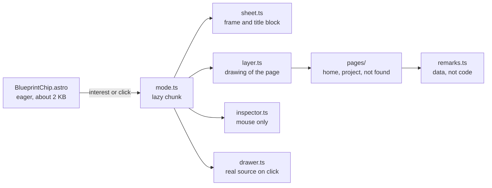

# 📐 Blueprint mode

A mode that turns the page into a technical drawing of itself. It is the one showpiece of the
site, and it is made to prove the claim behind it: the code is as good as the page.

## What a visitor gets

- A **Blueprint** chip at the end of the header, and an entry in the command palette (Ctrl K,
  "Blueprint mode"). A link ending in `/#blueprint` opens a page straight in the mode.
- A blue sheet with a border, lettered zones, a title block, a label on every block with the
  name of the file that renders it, dimensions measured from the real elements, handwritten
  remarks and a bill of materials.
- A **click opens the real source** of the component that rendered the thing, with the likely
  line marked. Nothing navigates while the mode is on.
- A mouse also gets a crosshair with a readout of the element under it. Touch gets neither the
  crosshair nor navigation: a tap opens the code.
- Turning it off puts the page back exactly as it was.

## How it is built

Only the chip and a small script ship with every page (about 2 KB of script gzipped, plus the chip's markup and styles). The mode itself is
a separate chunk of about 15 KB gzipped, loaded when someone shows interest in the chip (hover, focus or touch) or
uses it. Its styles are inside that chunk and go in through the CSSOM, so they are not in the
page's HTML or stylesheets, and the content security policy allows them.

| Module | What it does |
| :--- | :--- |
| `src/components/BlueprintChip.astro` | The entry point: the chip, its teaser and the loader. The hint and the corner animation are CSS, driven by two attributes |
| `src/blueprint/mode.ts` | Turns the mode on and off with the circle reveal, owns the session (an `AbortController`), and shows a glimpse (`peek`) |
| `src/blueprint/layer.ts` | The drawing: one SVG as big as the page, built again when the page changes size |
| `src/blueprint/sheet.ts` | The sheet border, the title block (a chip after the first screen) and the stamp |
| `src/blueprint/pages/` | What is drawn on each kind of page. A page is a list of remarks (`remarks.ts`) plus a few dimensions |
| `src/blueprint/drawing.ts`, `svg.ts`, `marks.ts`, `dimensions.ts`, `hand.ts`, `table.ts`, `bubble.ts` | Small drawing helpers. Everything is built with DOM calls, never with strings |
| `src/blueprint/drawer.ts`, `sources.ts`, `highlight.ts`, `locate.ts` | The code drawer: read the source of a file, color it, find the line |
| `src/blueprint/inspector.ts` | The crosshair and its readout |
| `src/blueprint/teaser.ts`, `memory.ts`, `handwriting.ts`, `peek.ts` | The way in: teaser, what the browser remembers, the handwriting font, the glimpse on hover |
| `src/styles/blueprint.css` | The palette (token overrides) and the styles of everything above |
| `scripts/blueprint-bom.mjs` | After the build, measures what each page references and writes `dist/blueprint/bom.json` |

Rules the code keeps:

- **Off means off.** Everything the mode adds is mounted in `start` with the session's abort
  signal, and removed when it aborts: the nodes, the listeners, the attribute. A test checks it
  on the home page, a project page and the 404.
- **No inline styles.** Delays and positions go through `element.style`, which the CSP allows.
  Text is always set as text.
- **Real data only.** Dimensions, fonts and colors are read from the page and from `tokens.css`.
  The sources are the repository's own files. The bill of materials is measured by the build.
  Remarks are lists of facts, each tied to an element, and nothing is drawn when its element is
  not on the page.
- **Same drawing every time.** The hand-drawn arrows use a seeded random generator.

## Where the real source comes from

`sources.ts` uses `import.meta.glob('/src/**/*.astro', { query: '?raw' })`, so every Astro file
becomes its own small lazy chunk and a file is fetched only when something it renders is clicked.
Each component marks its root with `data-bp="File.astro"`, and the owner of a clicked element is
the nearest ancestor with that attribute. When you add a component, give its root that attribute.

## The bill of materials

`npm run build` runs `scripts/blueprint-bom.mjs` after Astro. For each page it counts what the
page points at: its HTML, the stylesheets and scripts it links, the font files named in its
`@font-face` rules and its images. Text is counted gzipped, fonts and images as they are. Fonts
load only when used, so the font count is what the page can load. In development there is no
build, so the table is simply not drawn.

## The stamp and the title block

The stamp says **CI PASSED** only for a build of the `main` branch, because only a pull request
with every required check green can get there (branch protection). Any other build is stamped
**PREVIEW**. `astro.config.mjs` works out `onMain` from the host's CI variables (`WORKERS_CI_BRANCH` on
Cloudflare, `GITHUB_REF_NAME` on GitHub Actions). A build on a laptop never is, whatever branch
it is on. The title block shows the build date and commit from the same place.

## The way in

The chip draws its corners now and then, and a handwritten hint points at it for 7 seconds on
every visit. Moving, scrolling or typing does not hide the hint, going for the chip does. Both stop for good after the first use (`localStorage`, every access is guarded) and neither
runs with reduced motion. Hovering the chip lights the column lines and draws the name's
dimensions, then removes them. The handwriting font (Caveat) is declared on every page but only
downloaded when a hint or the drawing needs it.

## Phones

Below 900 px wide the drawing is the short version: the sheet, the labels, a compact title
block and short captions under a few elements instead of long arrows. There are no dimensions,
no bill of materials and no stamp, and there is no crosshair on touch.

## Print

Everything the mode adds has `data-blueprint-ui` and is hidden in print, and the palette applies
to the screen only, so a printout is the plain page.

## Known limits

- It is tested in Chromium only. The circle reveal uses view transitions and the styles use
  constructable stylesheets (Safari 16.4 and up). Safari on a phone has not been tried: check it
  by hand.
- The handwritten remarks are about this site's current pages. When a page changes, check its
  remarks in `src/blueprint/pages/`.
