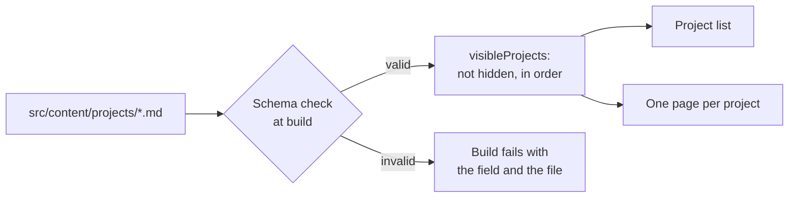

# 📝 Content

How the projects on the site are stored, and how to add, hide or remove one.

## One file per project

Every project is a Markdown file in [`src/content/projects/`](../src/content/projects/).
The site builds its project list and one page per project from these files, so adding
or removing a project never needs a code change.

## Add a project

1. Put the screenshots in `src/assets/projects/<name>/` (WebP, about 1600 px wide). The
   first one is the cover in the project list, so it must look right cropped to its top.
2. Add `src/content/projects/<name>.md` with the fields below. The text under the
   fields is the project's description.
3. Run `npm run build`. A mistake in a field fails the build and names the file.
4. Add its page, `/projects/<name>/`, to [`e2e/routes.ts`](../e2e/routes.ts) and to the
   phone title check in `e2e/project-row.spec.ts`.

On its page, a click on a screenshot opens it large. Esc or a click closes it.

## The fields

The schema is in [`src/schemas/project.ts`](../src/schemas/project.ts).

| Field | Required | What it is |
| :--- | :--- | :--- |
| `title` | yes | The project name |
| `summary` | yes | One line, shown in the list and under the title |
| `order` | yes | Position in the list, from 1 |
| `hidden` | no | `true` takes the project off the site and keeps the file. Default `false` |
| `type` | no | `Side project` (the default) or `Website`. Shown in the facts on the project page |
| `screenshots` | yes | One or more, each with `src` (a path relative to the file, checked and optimized), `alt` (for screen readers) and `caption`. The first is the cover |
| `links.github` | yes | The repository |
| `links.live` | no | The live preview. Leave it out for a project that is not an app |
| `stack` | yes | The technologies, shown on the project page only |
| `decisions` | no | The case study: three to five entries of `title` and `text` |

## Hide or remove a project

- **Hide:** set `hidden: true`. The project leaves the list, its page is not built, and
  it is skipped as the next project. The file stays, so it can come back.
- **Remove:** delete the file. Delete its folder in `src/assets/projects/` too.

`visibleProjects()` in [`src/lib/projects.ts`](../src/lib/projects.ts) is the one place
that applies this, and it has unit tests.

## Write the case study

The `decisions` come from the project's own README and docs, where the choices are
already written down. Each entry is the choice, the reason and the trade-off, in plain
words. A project with thin docs gets fewer entries, not filler.

> [!IMPORTANT]
> Only write what is true. Every claim about a project or its author must trace to the
> project's repository or to the author.

## Keep projects up to date

The skill [`update-projects`](../.agents/skills/update-projects/SKILL.md) compares the
entries with their public GitHub repositories and drafts an entry for a new one. It
lives in `.agents/skills/`, which Codex, VS Code and other agents read. `.claude/skills`
is a symlink to it for Claude Code, so there is one copy.

- Run it by asking your agent to "update the projects", or "add the project
  <owner/name>".
- The helper `node scripts/repo-facts.mjs --entries` prints the facts it works from.
  It reads public repositories only and writes nothing.
- The skill may change only `src/content/projects/*.md` and a new project's screenshots. It
  shows every change before writing it, and new drafts start with `hidden: true`.
