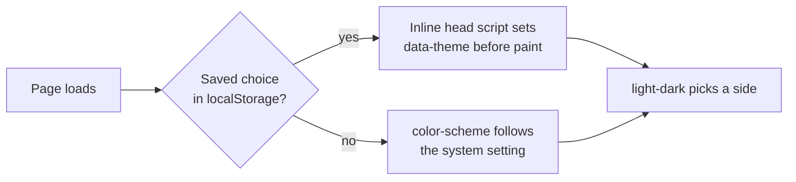

# 🎨 Design system

The tokens, the themes and the motion rules, and where each one lives.

## Tokens

All raw colors, the type scale, the spacing scale and the breakpoints are defined in
[`src/styles/tokens.css`](../src/styles/tokens.css). Nothing else in the code uses a
raw color.

| Token | Dark | Light | Used for |
| :--- | :--- | :--- | :--- |
| `--bg` | `#0b0b0c` | `#f4f3ef` | Page background |
| `--fg` | `#ededee` | `#0e0e10` | Text |
| `--muted` | `#8e8e94` | `#66666c` | Secondary text, labels |
| `--rule` | `#26262a` | `#d9d7cf` | Hairlines |
| `--panel` | `#111113` | `#ecebe5` | Framed figures |
| `--accent` | `#a78bfa` | `#4f46e5` | The one accent: violet, used sparingly |
| `--on-accent` | `#0b0b0c` | `#ffffff` | Text on the accent |

Each color is one declaration, `light-dark(light, dark)`. In Tailwind they are
`bg-bg`, `text-fg`, `text-muted`, `border-rule`, `bg-panel`, `text-accent`.

### Changing the accent

Edit the two `--accent` values (and `--on-accent` if needed) in `tokens.css`. Then run
`npm test`: it checks the WCAG AA contrast of every text pair in both themes, so a
color that is too weak fails.

Three static files carry the color and are not generated from the tokens. Redo them
when the accent changes:

| File | What it is |
| :--- | :--- |
| `public/favicon.svg` | The logo as a favicon |
| `docs/brand/banner-dark.svg`, `banner-light.svg` | The README banner |

## Themes

Dark is the default look, and the system setting wins when it asks for light. A
visitor can override it with the toggle, and the choice is remembered.

- `:root` sets `color-scheme: dark light`, so `light-dark()` follows the system.
- `data-theme="dark"` or `"light"` on `<html>` forces one side.
- The inline script in `BaseLayout.astro` runs before the body is painted, so there is
  no flash of the wrong theme.
- The toggle ([`ThemeToggle.astro`](../src/components/ThemeToggle.astro)) is rendered
  hidden and shown by its script, because it cannot work without JavaScript.

## Typography

Geist and Geist Mono, self-hosted by the Astro Fonts API (normal style only, variable
weight, the `latin` subset, plus `latin-ext` for Geist). Geist is preloaded.

A fluid scale, `clamp()` based, so one layout serves every width:

| Utility | Range | Used for |
| :--- | :--- | :--- |
| `text-step-0` | 1.03 to 1.2 rem | Body |
| `text-step-1` | 1.28 to 1.75 rem | Item titles, large lead text |
| `text-step-2` | 1.85 to 3.1 rem | The hero statement |
| `text-step-3` | 2.1 to 4.3 rem | Section titles |

The `mono` utility is the small label style: Geist Mono, uppercase, wide tracking.

## Spacing and breakpoints

| Utility | Meaning |
| :--- | :--- |
| `gap-gutter`, `px-edge`, `py-block` | Fluid column gap, page edge and section spacing |
| `max-w-page` | The page width, 88 rem |

Three breakpoints only: `sm` is 40 rem (phone and up), `md` is 64 rem (tablet and
up), `lg` is 75 rem. Utilities are mobile first. Use `max-sm:` for "phone only".

Hover effects sit behind `@media (hover: hover)`, so touch screens never get a stuck
hover. Tailwind's own `hover:` variant already does this.

## Motion

Defined in [`src/styles/motion.css`](../src/styles/motion.css).

- Pages cross-fade with a native CSS view transition (`@view-transition`). A browser
  without support just navigates.
- Intro: the hero name rises out of its line and the rest fades in (`data-intro`).
  Sections and project rows fade in as they scroll into view (`data-reveal`, CSS
  scroll-driven animation, where supported).
- The project image morphs between the home page and a project page, in both
  directions. [`src/scripts/transitions.ts`](../src/scripts/transitions.ts) sets
  `view-transition-name` on the one image that takes part, in `pageswap` and
  `pagereveal`, and scrolls the home page back to the row. Pages reached through a
  transition skip the intro (`html[data-transition]`).
- Speculation Rules prerender same-origin links on hover or tap (moderate eagerness).
- A theme change grows the new theme as a circle from the toggle.
- With `prefers-reduced-motion: reduce`, all transitions and animations are off and
  scrolling is instant.

## Other base rules

[`src/styles/base.css`](../src/styles/base.css) holds the violet text selection, one
focus ring style (`:focus-visible`), a faint static grain, and the custom scrollbar
(pseudo-elements for Blink and WebKit, the standard properties for Firefox).

## The shell

| Part | Where | Notes |
| :--- | :--- | :--- |
| Layout | `src/layouts/BaseLayout.astro` | Head, fonts, theme script, skip link, header, main, footer |
| Header | `src/components/Header.astro` | Logo and nav. The nav marks the section in view. On phones only Contact is shown |
| Footer | `src/components/Footer.astro` | Build date and commit, links, theme toggle |
| Link | `src/components/Link.astro` | A quiet underline, and a violet line that fills in from the left on hover |
| Container | `src/components/Container.astro` | The page width and edge padding |
| Logo | `src/components/Logo.astro` | The logo, one version only |

Site facts (name, links, section list) are in `src/config/site.ts`. The build date and
commit come from `astro.config.mjs`.
