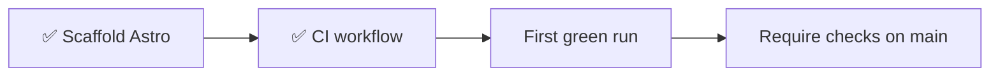

# 🔐 GitHub settings

Repository protections: what is on, and what waits for the repo to go public.

## Enabled

| Setting | State |
| :--- | :--- |
| Dependabot alerts and security updates | On |
| Delete branch after merge | On |
| `dependabot.yml` (weekly, grouped, npm and GitHub Actions) | On |

## Planned

Secret scanning is not available while the repository is private ("Secret
scanning is not available for this repository"). It is free on public
repositories, so these wait for the repo to go public.

| Setting | When | Notes |
| :--- | :--- | :--- |
| Secret scanning and push protection | When the repo goes public | |
| Branch protection on `main` | After the first green CI run on `main` | See below. Not yet tested on the private repo |

## Branch protection on `main`

Planned rules:

- Pull request required before merging.
- Required status checks, named as the CI jobs: `Lint, format and build`, `Browser tests`, `Lighthouse`, `Secret scan`.
- No force pushes, no deletion of `main`.
- Rules apply to admins too.

> [!IMPORTANT]
> A required check must already exist, or every merge is blocked waiting for a
> status that never arrives. That is why checks are required only after the first
> CI run.

> [!NOTE]
> Requiring pull requests also blocks direct pushes to `main`, so every change
> then goes through a branch and a PR.
